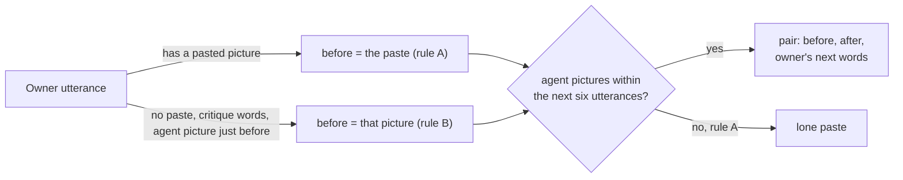

# Mining the owner's past screen critiques

The owner of the Kvit apps builds them with coding agents and is their one
expert user. While using an app, the owner often pastes a screenshot into the
agent's conversation and says what is wrong with it; the agent changes the app
and shows a picture of the result; the owner's next words show whether the
result was acceptable. `agents-ux.md` (sections 1.6 and 3.5) proposes turning
those past exchanges into two things a reviewer agent needs: a list of
failures the owner has actually flagged, and before/after example pairs the
owner accepted. Published studies found that a list of failures already seen
in the same product improves an agent's screens, whereas a list of general
best practice does not.

This file says what was extracted, from where, how, and with what limits. The
results are in the folder `agents-ux-mining/`:

| File | What it holds |
|---|---|
| `rubric.md` | The 31 recurring failures: a rule for each, how often it was raised, the owner's words, the cases, an accepted before/after pair, and what could catch it |
| `cases.jsonl` | One line per owner critique found (293), with the hand check's judgment and the picture paths |
| `scan.py` | The script that finds the critiques in the session transcripts and prints each one for checking |

## Result

Across 599 agent sessions in seven projects, the scan found 293 places where
the owner pasted a screenshot or criticised an agent's picture. Checked by
hand, 223 of them concern a screen; the other 70 are bug reports (55) and
questions (15). Of the 223, 149 are about Kvit Works (the app that runs coding
agents), 66 about Kvit Hub (the owner's dashboard over many projects) and 8
about kvit-ui, kvit-dictate and kvit-cash.

What the owner flags, grouped (the entries are in `rubric.md`):

| Group | Cases | Share |
|---|---:|---:|
| What a screen leads with: result before progress, only what needs the user, each thing once | 28 | 13% |
| How a screen is organised: separate subjects, fitting the window, panes, like items together | 28 | 13% |
| Words on screen: internal names, error messages, long or robotic labels | 51 | 23% |
| State and response: background work, the result of an action, marks, false alarms | 35 | 16% |
| Reaching the next step: a way forward from every state, showing what is being decided | 16 | 7% |
| Controls: links, desktop basics, one text editor | 25 | 11% |
| Drawing and likeness: rendered Markdown, same look for the same thing, spacing, clean drawing | 40 | 18% |

About half of the critiques (107 of 223) concern what a screen shows first,
how it is organised, what state it reports and where the user goes next. The
apps' existing checks and the platform-guideline rules in
`docs/ui-guidelines/` work at the level of single controls and words; three of
the 47 items in that reviewer checklist touch this half, and nothing else
checks it before the owner does. Wording is the largest single
group, and its two biggest entries, internal names on screen (10 cases) and
error messages that do not say what to do (15), can partly be checked by a
program. Controls and drawing make up the remaining 29%. Of those, 42 cases
fall under five entries that one component in kvit-ui or the block editor
could fix for every screen at once: links that open on Ctrl+click everywhere,
Markdown rendered everywhere, one editor for every text box, the desktop basics
of dropdowns, dialogs and tooltips, and clean drawing.

How often the agent's first fix was enough: 121 of the screen critiques have a
before and an after picture. In 97 of them the owner's next words judge the
fix. The owner accepted 60, accepted the direction but asked for more change
to the same thing in 34, and rejected 3. So 37 of 97 (38%) needed another
round. That figure is the baseline for the experiment `agents-ux.md` proposes
(section 2.5), which counts the corrections each way of building a screen
still needs.

There are 92 usable before/after pairs: pictures of the same screen before and
after, with the change visible. 73 of them have an approving verdict (44
approved outright, 29 approved with a further request), and `rubric.md` names
one for each failure where one exists.

## Sources

Each Kvit project keeps its agent sessions in
`<project>/.kvit/sessions/<id>/chat.md`, with the pictures an agent made in
`<id>/pictures/` and the owner's pastes in `<project>/.kvit/pasted/assets/`.

| Project | Where read | Sessions | With pictures |
|---|---|---:|---:|
| Kvit Works | `~/kvit-works` | 443 | 237 |
| Kvit Hub | `~/kvit-hub` | 80 | 62 |
| kvit-ui | `/kvit/projects/kvit-ui` | 31 | 14 |
| kvit-coder | `~/kvit-coder` | 20 | 3 |
| kvit-dictate | copied from `D:\projects\kvit-dictate\.kvit` on the Aorus PC | 10 | 3 |
| kvit-notes | `~/kvit-notes` | 9 | 6 |
| kvit-cash | `~/kvit-cash` | 6 | 4 |

`/kvit/projects/kvit-works` and `~/kvit-works` are the same folder, and so on
for the other projects. kvit-ui's checkout under `~` keeps no sessions. Two
kvit-ui sessions are left out because they hold this research itself, and their
pastes are screenshots of documents. On Aorus, `H:\kvit-works-records` holds
copies of the same session folders, with one more kvit-ui session that has no
pastes. The other projects on Aorus with sessions (algo, ha-config, piperd,
sqeezeamp, wan-dancer: 10 sessions) have no pasted pictures, and neither has
`/kvit/projects/allocator` (one session).

## How a transcript is read

A transcript is a sequence of turns, each opened by a line such as
`<!--kvit turn=4 role=assistant ...-->`. The owner speaks in two places:

- **A user turn.** User turns that are not the owner are skipped: a brief
  written by another project's agent, and the messages the app writes by
  itself after an agent's reply ("The checks found these problems in your last
  reply", "Now ask your question again", "Your turn changed files … and ended
  without asking").
- **An answer inside an agent's turn,** written as a quoted line
  `> <question> — **<answer>**`. The agent asked a question and the owner
  answered while the turn continued. Many critiques arrive this way, as free
  text instead of one of the offered choices.

A picture the owner pasted is written `` and named
`message-…png` or `capture-…png`. An agent's picture has a caption.

`scan.py` turns each transcript into a list of owner and agent utterances and
then finds two kinds of item:



- **A pair** (138 found): a before picture, the agent's pictures that follow
  (the after; a picture captioned or named only "before" is not counted as
  after), and the owner's next words, which are the verdict candidate.
- **A lone paste** (155 found): an owner paste that no agent picture
  followed. It gives no pair, but it still records what the owner found wrong,
  and 71 of the 102 screen critiques among them were fixed according to the
  agent's reply.

Rule A takes every paste whatever its words, because the owner's critiques use
too many different words for a word list ("UI is bad!", "hard to distinguish",
"doesn't look like header"). The hand check separates screen critiques from
bug reports. Rule B uses a list of critique words in `scan.py`, since without
it every reply after an agent's picture would count.

## Hand check

Seven reviewer agents checked the items in parallel: five took about 27 pairs
each and two took about 77 lone pastes each. Each was given a brief: run
`scan.py show` (or `show-paste`) for its items, open the before picture of
every item that might concern a screen, open the after pictures where needed,
read the transcript around the case when the excerpt was not enough, and
record a judgment. The main session checked the five items that appeared after
the script's last fixes, then read every screen critique's description and
assigned each to one failure in `rubric.md`.

Fields of `cases.jsonl`:

| Field | Meaning |
|---|---|
| `id` | project, session and line of the owner's words, such as `works/20261022-f46b4c/L18` |
| `source` | `pair` or `paste` |
| `app`, `screen` | the app and screen criticised, which is not always the project the session belongs to (Kvit Works' agent chat appears in Hub sessions) |
| `kind` | `ux` (how a screen looks, is arranged, is worded, guides or responds), `bug` (something does not work), `mixed`, `other` (a question) |
| `owner_words` | the owner's critique, at most 30 words |
| `wrong`, `fix`, `lesson` | what was wrong in the owner's view, what the agent changed, and the general rule a reviewer could check another screen against |
| `category`, `also` | the reviewer's category: priority, structure, wording, feedback, next-step, interaction, spacing-visual, visual-bug, consistency |
| `rubric` | the entry of `rubric.md` the critique counts under (screen critiques only) |
| `after_shows_fix`, `verdict`, `verdict_words`, `pair_quality` | pairs only: whether the after picture shows the fix; the owner's verdict (`approved`, `corrected` = accepted but asked for more on the same thing, `rejected`, `moved-on`, `none`); the words that show it; whether the two pictures make a usable pair |
| `fixed`, `followup` | lone pastes only: whether the agent's reply says the screen was changed; the owner's next words if they judge it |
| `before`, `after` | picture paths on this machine; `(lost)` marks the 12 pictures (in 6 items) that no longer exist |

## Limits

- **The judgments are the reviewer agents' reading,** not the owner's. The
  owner's own words are quoted in every item, so a disputed judgment can be
  checked against them. The main session read the reviewers' reports and the
  description of every screen critique when grouping them, but did not re-open
  their pictures.
- **The automatic picture lists are less reliable than the judgments.** The
  reviewers found and corrected these per item: under rule B the before
  picture is sometimes an earlier, unrelated agent picture; when the owner
  answers twice with no agent text between, the excerpt runs on into the next
  round and takes its after picture and verdict; an after picture is sometimes
  a mockup, a diagnosis or a reference screenshot (Claude's own app, given as
  a model). `pair_quality` says whether the listed pictures make a usable
  pair.
- **Critiques with no picture at all are missed,** unless an agent picture
  came just before them. Two reviewers found such critiques in the sessions
  they read (for example `hub/20261031-7729b2`, line 569: "'Discuss this
  project', 'Plan this project' sound too much like narratives, not
  actions").
- **One owner, two main apps.** Two thirds of the screen critiques are about
  Kvit Works and almost all the rest about Kvit Hub, so the failures describe
  this owner's judgment of these apps. kvit-notes contributes none: its
  sessions hold briefs from other projects' agents rather than the owner's
  pastes.

## Running the scan

```sh
cd agents-ux-mining
export KVIT_EXTRA_SESSIONS=dictate=~/.cache/kvit-ux-mining/kvit-dictate/sessions
python3 -I scan.py counts                    # sessions, pictures and items per project
python3 -I scan.py scan --tsv pairs.tsv      # the pairs as a table
python3 -I scan.py pastes --tsv pastes.tsv   # the lone pastes as a table
python3 -I scan.py show works/20261022-f46b4c/L18          # one pair, for checking
python3 -I scan.py show-paste works/20260921-4a956a/L40    # one lone paste
```

`KVIT_EXTRA_SESSIONS` names copies of sessions that exist only on the Windows
PC. kvit-dictate's `sessions` and `pasted` folders were copied from Aorus into
`~/.cache/kvit-ux-mining/kvit-dictate/` on 24 November 2026; copy them again
for newer sessions.

A new scan finds new sessions' items, which have no judgment yet. Items already
in `cases.jsonl` keep their `id` as long as their transcript is unchanged.

## Uses

- **The owner's confirmation.** The 31 entries in `rubric.md` are written from
  the owner's words but grouped by an agent; the owner may merge, split or
  reword them.
- **Step 4 of the method in `agents-ux.md`.** A reviewer agent that did not
  build a screen checks it against `rubric.md`, with the accepted pairs as
  examples of good.
- **Checks in the build.** Two entries are now checks in kvit-ui's `uitest`
  that the apps' tests can call: `Session.CheckReach` for R06 (fits the
  window) and `Session.CheckResponds` for R16 (visible result of every
  action). R19 (disabled controls) was already checked for buttons by
  `Session.CheckLabels`. The other entries marked "a program" (R07 panes, R10
  internal names, R17 marks) can become tests in the apps, in the form kvit-ui
  already uses: a list of known problems that can only shrink.
- **Fixes in one component.** The entries marked "one component" (R23 links,
  R24 desktop basics, R26 one text editor, R27 rendered Markdown, R31 clean
  drawing, and R09 in Kvit Works' conversation view) can be fixed once in
  kvit-ui or in the block editor, for every app.
